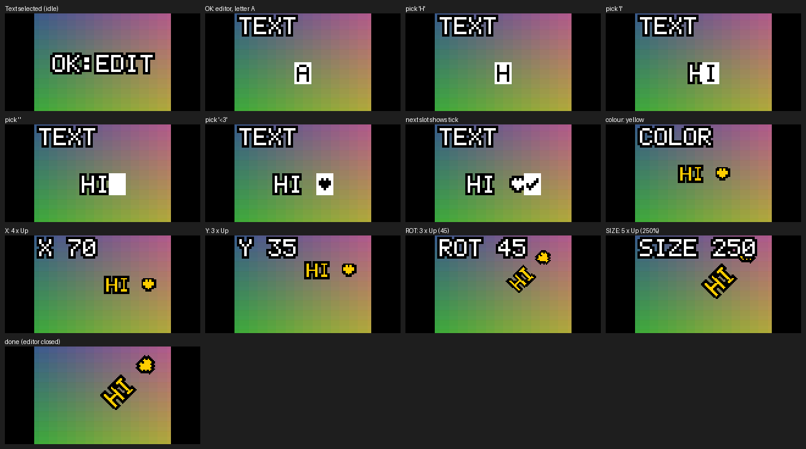

# hark_charmera

**Charmera**: four new effects for the Kodak Charmera keychain camera, patched
into its stock firmware. Every stock filter and frame still works. The
documentation is a site of its own, **https://charmera.felipeharker.org/**,
opened from its tile on the portfolio, [felipeharker.org](https://felipeharker.org/).



| Effect | What it does |
|---|---|
| 12 Sepia, 13 Cyanotype, 14 Faded | Color looks applied by the camera's image processor, like the stock Warm/Cool/B&W, so they show live in the viewfinder |
| 15 **Text** | A pixel-font caption you type, color, place, rotate and size with the camera's buttons; drawn live on the viewfinder and stamped into every photo |

> **Status: not yet run on a camera.** The patch is built from a public dump
> of the stock firmware and checked by 99 emulator tests that run the real ARM
> code, but nobody has flashed it yet. For the **original** Charmera only
> (yellow Kodak logo at power-on); the Millennium and CLOT editions run
> different firmware.

The site is built to the Hark web standards, which live in
[`hark_web`](https://github.com/felipeharker/hark_web) and are served at
https://felipeharker.org/standards/. It is a project site in the portfolio's
Personal section: its running head and site links are Portfolio, the
Ornithology Report, Dove Habitat and Charmera. The reverse-engineering notes
are in [`REPORT.md`](REPORT.md).

## Using the Text Effect

1. In photo mode press **Up/Down** until the **T** icon shows. The viewfinder says `OK:EDIT` until there is text.
2. Press **Play/OK** to open the editor. In every step **Up/Down** change the value and **Play/OK** confirms:

   | Step | Up / Down | Play/OK |
   |---|---|---|
   | TEXT | A–Z, 0–9, space ! ? . , - & : ' ♥ ✓ | keep the letter, next slot (12 max); on **✓** finish |
   | COLOR | white, yellow, red, blue, green, pink, black | next |
   | X / Y | right/left, up/down in 5 % steps | next |
   | ROT | 15° counter-clockwise / clockwise | next |
   | SIZE | ±10 % (10–400 %, starts at 200 %) | close the editor |

3. Shoot as usual: the text is stamped into the photo (not into video). The setup is kept until power-off.

## What Is Not Here

No firmware is in this repository, original or patched: it is Kodak's, and
third-party material stays out of git (`hark_web`, `AGENTS.md`). Nor is
anything extracted from it — disassembly, frames, icons. The build patches a
public dump on your own computer. Ignored, on disk only: `third_party/` (the
dumps), `build/` (update packages), `work/` and `source/` (working files),
`.venv/`.

## Firmware Dump

Clone the two public dumps into `third_party/`. The build reads
`third_party/keychain-camera-plus/dumps/charmera_stock_latest.bin` (or
`CHARMERA_DUMP`), checks its code against a pinned SHA-256, and cross-checks
it against the Project-Sirius dump:

```bash
git clone --depth 1 https://github.com/benbadio/keychain-camera-plus third_party/keychain-camera-plus
git clone --depth 1 https://github.com/Khimira/Project-Sirius third_party/Project-Sirius
```

## Build and Test

Python 3.11+ (no other compiler needed: `ziglang` provides clang and lld).

```bash
python -m venv .venv
.venv/Scripts/python -m pip install -r requirements.txt
.venv/Scripts/python tools/build_fx.py            # optional: --stamp YYYYMMDDhhmm
.venv/Scripts/python tools/emu_test.py            # must end with RESULT: ALL PASS
```

`build/fx/JH_5408<stamp>_<sum>.bin` is the update; `build/stock_restore/`
holds a stock package to go back with. The build is reproducible: the same
inputs and stamp give the same file.

To change a look, edit `looks.json`. To change the text stamp, edit
`fx_text/fx_text.c` or the font in `tools/fx_tables.py`. Then rebuild with a
**new** stamp and rerun the tests.

## Flash

1. Charge the camera. Back up `DCIM` from the SD card.
2. Copy **one** `JH_5408…_….bin` to the **root** of the FAT32 card, with no other `JH_5408*.bin` beside it. Don't rename it.
3. With the camera off, insert the card and power on. Wait for `Upgrade 0% → 100%` without pressing anything.
4. Remove the card; the camera restarts. Press Up in photo mode past Pixel-Gray: Sepia, Cyanotype, Faded and Text should follow.

The update resets the camera's settings and clears photos in its internal
memory; photos on the SD card are not touched. To go back, flash the stock
package the same way, then **delete it from the card** (stock firmware has a
different stamp, so it would flash again at every power-on).

## Layout

```
hark_charmera/
  README.md            this page
  REPORT.md            reverse-engineering notes: layout, effects, updater, the patch, verification
  AGENTS.md            rules for coding agents (CLAUDE.md points here)
  render.yaml          the Render service, recorded
  looks.json           the three color looks
  requirements.txt     Python packages for the build and the tests
  fx_text/             the text stamp: fx_text.c and link.ld (where it goes in memory)
  tools/
    build_fx.py        patch a dump, compile fx_text, package for the SD updater
    emu_test.py        run stock and patched code in an emulator (Unicorn): 99 checks
    fx_tables.py       5x7 font, palette, cosine table, the Text icon
    free_spans.py      find firmware code nothing references (where new code can go)
    reach.py, check_region.py, deadcode.py, fwdis.py, d.py   analysis and disassembly helpers
    gppack.py, frames.py, preview_looks.py                   resource pack, frames, look preview
    site.mjs, check.mjs, serve.mjs                            the site: its links, its check, a local server
  site/                published as https://charmera.felipeharker.org/
  docs/                images for this README and REPORT.md (emulator renders)
```

## The Site

```bash
node tools/serve.mjs     # http://localhost:8000/
node tools/check.mjs     # before a commit
```

Render publishes `site/` as it is, from `main`, once the Check workflow
passes (`render.yaml`, synced as a Blueprint); `charmera.felipeharker.org` is
a Porkbun CNAME to the service's onrender.com address.

Kodak and Charmera are trademarks of their owners; this project is not
affiliated with them.
