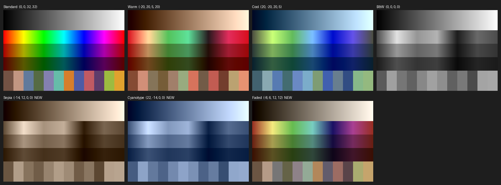
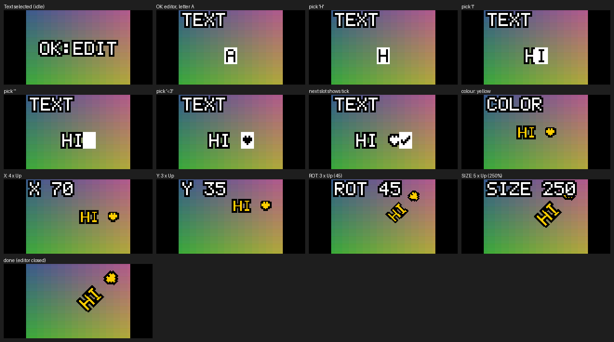

# Kodak Charmera firmware review: filters, frames and custom effects

Date: 2026-11-04. Firmware analysed: **JH5408 20250520**, built **Oct 14 2025** (original-series Charmera).
Status: v1 (colour looks) and v2 (looks + Text stamp) are built and emulator-verified. Neither has run on a camera yet.
Site: https://charmera.felipeharker.org/

## 1. The Camera

| Item | Finding |
|---|---|
| USB device | `VID_1B3F PID_8301` (Generalplus), USB mass-storage only |
| USB drive | The **microSD card** (FAT32), not the firmware: `DCIM\` for photos and video, and an empty `SPIDCIM\` |
| Firmware location | Internal 2 MiB SPI NOR (Puya PY25D16HB) next to a Generalplus GPCV1235F (ARM7TDMI, no MMU; SDK `GPCV1235F_WIFI_SingleCam_SDK_20191212`) |
| Reading firmware over USB | Not possible with stock firmware (vendor flash-read commands are gated). Analysis used two public full-flash dumps |
| Buttons | Shutter, On/Off, Up, Down, Play/OK (no Left/Right). Screen 160×80 |

The two public dumps (Project-Sirius `Original_Firmware.bin`, keychain-camera-plus `charmera_stock_latest.bin`) are
**byte-identical in the whole code/resource region** (`0x000000–0x16FFFF`). They differ only in per-unit settings and
internal-memory photos.

**Is a given camera on this firmware?** For the unit this was built against, strong evidence says yes:
- Its photos taken with the stock frames match the dumped frame art pixel-for-pixel (mean error 1.7–3.7 / 255, i.e. JPEG noise). CLOT editions ship different, exclusive frames.
- Its photos' JPEG/EXIF layout is byte-identical to photos stored in the dump (apart from timestamps and quality table).
- On the camera itself: it should power on to the yellow Kodak logo. The Millennium Edition reportedly has a different logo and sensor, and original-series firmware breaks capture on it.

## 2. Firmware layout

**Flash map (2 MiB)**

| Flash range | Contents |
|---|---|
| `000000–0001FF` | `SPII` boot header (not loaded to RAM) |
| `000200–10B12F` | Code + rodata + initialised data → loaded at RAM `0x000000` (**RAM = flash − 0x200**) |
| `120000–168FFF` | `GP+` resource pack: 43 named entries (GPZP = raw DEFLATE, JPG, WAV) |
| `170000–17EFFF` | Settings log (512-byte records, wear-levelled) |
| `17F000–17FFFF` | Internal-memory photo index |
| `180000–1EFFFF` | Internal-memory photos (used when no SD card) |
| `1F0000–1FFFFF` | Last block, empty in both dumps |

**RAM map** (from the reset code): code/rodata `0x000000–0x0FF86F`, `.data` `0x0FF870–0x10AF2F`, `.bss` `0x10AF30–0x1AE74F`
(zeroed at boot), stacks/heap above. There are no CP15 (MMU/cache) instructions, so memory is flat and writable.

## 3. How filters and frames ("stickers") work

Everything is driven by **one byte: the effect index at RAM `0x10FBC5`**. In photo mode, Up (message `0x7002`) moves to the
next effect and Down (`0x7003`) to the previous one. The index resets to 0 when photo mode is entered and is not saved.

| Effect | Name | Implementation | Live preview | Icon |
|---|---|---|---|---|
| 0 | Standard | colour processor | yes | none |
| 1 | Warm | colour processor | yes | 0x60 flame |
| 2 | Cool | colour processor | yes | 0x61 snowflake |
| 3 | B&W | colour processor | yes | 0x62 half circle |
| 4–7 | Frames: film strip, Kodak window, pixel stickers, 1987 camera | composited after capture | overlay `PV000–PV003` | 0x63–0x66 |
| 8–11 | Pixel red / blue / yellow / gray | CPU code after capture | CPU code on viewfinder | 0x67–0x6A |
| 12–14 | **Sepia / Cyanotype / Faded** (new, v1) | colour processor | yes | 0x2A–0x2C |
| 15 | **Text** (new, v2) | CPU code after capture | CPU code on viewfinder | 0x2D |

**Colour modes** (`cdsp_mode`, RAM `0x2D368`) send two IPC commands to the image processor (`0x30000013` via
`0x64958`, `0x30000014` via `0x649B8`), each with `(Cb offset, Cr offset, Cb gain, Cr gain)`, gain in 1/32 steps:

| Mode | Cmd 0x13 | Cmd 0x14 |
|---|---|---|
| Standard | (−1, +2, 40, 40) | (0, 0, 32, 32) |
| Warm | (−20, +20, 5, 20) | same |
| Cool | (+20, −20, 20, 5) | same |
| B&W | (0, 0, 0, 0) | same |

**Frames / stickers.** Resources `F_<frame>_<strip>.GPZP`, 3 strips × 800×200. Format "GP420": per row pair, a Y line,
a U/V line and a Y line (240,000 bytes per strip). Transparent where both lumas of a 2-pixel group are `0x8C`. After the
shot, `frame_apply` (RAM `0xECF0`) inflates each strip and the compositor (`0xEBA4`) writes non-transparent pixels into
the 800×600 capture buffer. `PV00n.GPZP` (112×80) are the viewfinder overlays.

**Pixel filters.** After the shot (`0x6E3A0`), the frame is scaled to an 800×600 4:2:2 work buffer. Each pixel with
luma ≥ 124 becomes the palette colour and darker pixels become black (`0x6E2DC`), then the frame is scaled back. A twin routine
(`0x15EB8`) does the same on the 160×80 viewfinder.

**Icons.** The 119-slot OSD icon table lives in `.data`: descriptors at RAM `0x1000D4` (w, h, transparent key `0x8C71`, x, y)
and RGB565 pixel pointers at `0x106F38`. 48 slots are unused SDK placeholders that share a dummy pointer.

## 4. SD-card updater (verified in code)

- At boot, `0x21618` looks for `C:\JH_5408*.bin`. It triggers when the 12-digit stamp in the name differs from the stamp stored in the firmware (`202505201029`, RAM `0x216C4`).
- The filename format is `JH_5408<YYYYMMDDhhmm>_<8 hex>.bin`, where the hex is the 32-bit sum of all file bytes.
- The file is written from flash offset 0 in 64 KiB blocks, and each 256-byte page is verified with up to 5 retries.
- Afterwards, **one extra block is erased at (end of file + 0x10000)**. A full 2 MiB file would wrap around and erase block 1 (the camera would not boot). A 0x1E0000 file erases the empty last block.
- After 100%, remove the card. The camera chimes and resets.

## 5. v1: colour looks (effects 12–14)

Hardware tints that work exactly like Warm/Cool/B&W, so they show live in the viewfinder:

| Effect | Look | (Cb off, Cr off, Cb gain, Cr gain) | Icon slot |
|---|---|---|---|
| 12 | Sepia | (−14, +12, 0, 0) | 0x2A |
| 13 | Cyanotype | (+22, −14, 0, 0) | 0x2B |
| 14 | Faded | (−8, +6, 12, 12) | 0x2C |

*Approximate preview: the processor's exact maths is inferred from the stock values, not measured.*

| RAM | Change |
|---|---|
| `1DC70, 1DC78, 1DC8C, 1DCFC, 1DD18` | Up/Down handlers wrap at the new last effect and pass the raw effect to `cdsp_mode` |
| `2D368–2D423` | `cdsp_mode` rewritten table-driven (effect → mode map + 7 parameter sets). Modes 0–3 send byte-identical values |
| `1DD38` | Icon ID looked up from a table instead of `effect + 0x5F` (0x5F+12 would show a language icon) |
| `1DC60, 1DCF0` | "Hide effect icons" also hides the new icons |
| `.data 1002CC…, 106FE0…` | Unused icon slots 0x2A–0x2D pointed at new 16×16 icons |
| `216C4` | Update stamp = package stamp, so the file left on the card does not re-flash every boot |
| `18764` | Version string → `JH5408  FX<yymmdd>`. It belongs to an SDK "Version" menu item (ID 0x42) that may not be reachable on the Charmera, so it isn't a reliable install check. Use the new effects instead |

## 6. v2: Text stamp effect (effect 15)

On the Text effect, Play/OK opens an editor. Up/Down change the value and Play/OK confirms, through these steps:
letters (A–Z, 0–9, space ! ? . , - & : ' ♥, ✓ to finish, max 12) → colour (white, yellow, red, blue, green, pink, black) →
X → Y (5 % steps) → rotation (15° steps) → size (10 % steps, 10–400 %, default 200 %). The text is drawn live on the
viewfinder and burned into the photo after capture. The setup is kept until power-off.

**How it hooks in** (RAM addresses, all sites checked against stock bytes):

| Site | Change |
|---|---|
| `1D9DC`, `1D9E8` | Messages `0x7002` (Up) / `0x7003` (Down) go to `stub_up`/`stub_down`. The editor consumes them only while it is open, otherwise the stock handler runs |
| `1D99C` | Message `0x7000` (Play/OK) goes to `stub_ok`. On the Text effect it opens or advances the editor, otherwise stock playback |
| `160E0` | Display task, every viewfinder frame (160×80 RGB565, photo area x 24–135): `fx_preview` draws the text and editor labels when effect = 15 |
| `6E458` | After capture: stock frame compositing, then `fx_capture` stamps the text into the 800×600 GP420 buffer before JPEG encoding |

Button codes come from the long-press pattern (short + `0x61`). Long-Down `0x7064` is the guide's language switch, so the codes are
`0x7000` OK, `0x7001` Shutter, `0x7002` Up, `0x7003` Down.

**Where the code lives:** C (`fx_text/fx_text.c`) compiled with clang (via zig) for ARM7TDMI, linked by `fx_text/link.ld` into
firmware code that nothing references (`tools/free_spans.py`; every region's stock bytes are hash-pinned in the build):

| Region (RAM) | Used / size | Contents |
|---|---|---|
| `036A60–0372A7` | 1512 / 2120 | renderer (rotation, scale, outline) |
| `0893A4–0899FF` | 1380 / 1628 | editor, viewfinder drawing, entry stubs |
| `0DF790–0DFC53` | 612 / 1220 | capture, labels |
| `0753A4–07590F` | 439 / 1388 | font/tables + editor state (RAM, kept until power-off) |
| `0ABB20`, `075F10`, `09ADC0`, `08EC00` | 512 each | icons for Sepia, Cyanotype, Faded, Text |

**Rendering:** 5×7 font, one-font-pixel outline, inverse-mapped nearest-neighbour rotation (Q14 cosine table). 100 % size
is 6 px per font pixel on the 800×600 photo. The same code draws the viewfinder (RGB565) and the photo (GP420), so the
preview matches the shot, including the viewfinder's slight horizontal stretch. All writes are clipped to the buffer.

## 7. Verification done (no hardware)

- Two independent dumps agree on the code region. SHA-256 is pinned for the base, the replaced function and every reused dead region.
- Every byte that differs from stock is inside the listed regions.
- `tools/emu_test.py` runs the **real ARM code** of stock and patched images in Unicorn: **99/99 pass**.
  - `cdsp_mode` for effects 0–16: stock modes identical, new modes correct.
  - Up and Down from every effect 0–15: correct next effect, colour parameters, icon shown, all effect icons hidden.
  - The stock OSD renderer draws all four new icons at (0, 56).
  - The post-capture pipeline runs frames only for 4–7 and Pixel only for 8–11; 12–15 don't touch either path.
  - The button dispatch routes OK, Up and Down to the editor only on Text with the editor open; otherwise they reach the stock handlers. A stale editor flag is cleared.
  - A full editor session (type `HI ♥`, yellow, move, rotate 45°, resize) with a viewfinder frame rendered after each step. The overlay costs about 0.56 M instructions per frame.
  - Text stamped into a photo buffer costs about 13.5 M instructions. Extreme sizes and positions never write past the buffer.
- Package checks: checksum = filename, size `0x1E0000`, trailing erase hits the empty last block, `SPII` header intact.

## 8. Risks and what is *not* verified

- **Not run on real hardware.** The emulator covers the changed logic, not the image processor, LCD or encoder.
- **Look strength** (v1) is a best estimate from Warm/Cool/B&W. Tune in `looks.json`.
- **Text feature assumptions** inferred from stock code:
  - The frame at `0x160E0` is the 160×80 RGB565 viewfinder; the stock Pixel preview reads and writes it the same way.
  - The capture buffer is GP420; the stock frame compositor writes it that way, and photos taken with the stock frames confirm it.
  - Up/Down could be swapped. If so, every direction is reversed but nothing breaks.
- The Text code only runs on the Text effect, plus a few instructions per key press and per frame. Boot and the SD updater are untouched, so stock, v1 or v2 can always be reflashed if the camera still boots.
- **Settings reset:** flashing replaces the settings block and clears any **internal-memory** photos. SD-card photos are not touched.
- **Bricking:** a power loss mid-update, or the wrong hardware variant, can leave the camera needing an SPI programmer (CH341A + SOIC-8 clip) to recover.
- **Community builds:** keychain-camera-plus "super" places its hooks at RAM `0x10AF40`, inside `.bss`, which the startup code zeroes, so the hooks are gone by runtime. Its "stock restore" also carries another person's internal photos and settings at `0x180000+`. The restore package built here blanks that area.

## 9. Files

| Path | What |
|---|---|
| `build/fx/JH_5408<stamp>_<sum>.bin` | The update package a build writes (not in git: it is Kodak's firmware, patched) |
| `build/stock_restore/JH_5408<stamp>_<sum>.bin` | A stock package to restore with (not in git) |
| `looks.json` | The three colour looks |
| `fx_text/fx_text.c`, `fx_text/link.ld` | Text feature source and memory layout |
| `tools/build_fx.py` | Patcher, compiler driver and SD packager |
| `tools/emu_test.py` | Emulator test suite |
| `tools/fx_tables.py` | 5×7 pixel font, colour palette, cosine table, Text icon |
| `tools/free_spans.py`, `tools/reach.py`, `tools/check_region.py` | Dead-code and reference analysis (code caves) |
| `tools/fwdis.py`, `tools/gppack.py`, `tools/frames.py`, `tools/preview_looks.py` | Disassembly, resource-pack and frame decoders, look preview |
| `third_party/` | The public dumps, cloned locally (not in git) |
| `site/` | The page at https://charmera.felipeharker.org/ |

Sources: [Project-Sirius dump](https://github.com/Khimira/Project-Sirius), [keychain-camera-plus](https://github.com/benbadio/keychain-camera-plus),
[Project-Sirius issue #1](https://github.com/Khimira/Project-Sirius/issues/1) and [#2](https://github.com/Khimira/Project-Sirius/issues/2) (updater format, variant warnings),
[Better Taste for a Tiny Camera](https://www.arjunsriva.com/posts/tiny-camera-better-taste/) (filter/frame notes),
[Charmera quick-start guide](https://cdn.shopify.com/s/files/1/0500/4692/7012/files/Charmera1.5_QSG_English.pdf?v=1781164680) (buttons).
